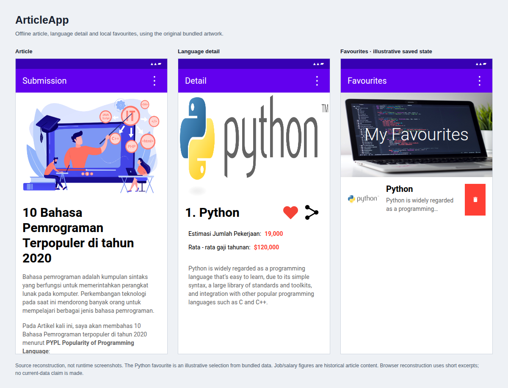
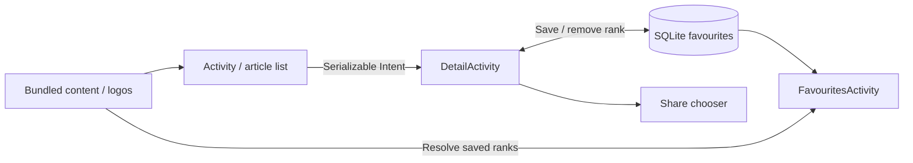

# ArticleApp

An offline Kotlin Android reader for a bundled article about ten programming languages. Browse language summaries, open details, save favourites locally, and share a description through Android’s share chooser.



*Source reconstruction, not runtime screenshots. The saved Python entry illustrates a possible local favourite state. Article text, artwork and historical figures come from the repository.*

## How it works



The app bundles its content and images rather than fetching an API. A language object travels to the detail activity through an Intent. `FeedReaderDbHelper` stores favourite rank IDs in SQLite; the favourites screen resolves those IDs back to `LanguageData`. Glide loads local images. The UI uses XML layouts and activity-managed state rather than a ViewModel/repository layer.

## Build

Open the repository in Android Studio with an Android SDK 30 installation and a JDK compatible with its Gradle 6.7.1 / AGP 4.2.0 toolchain, then run:

```sh
bash gradlew assembleDebug
```

Minimum Android version: 5.0 (API 21). The original build still declares `jcenter()`; dependency resolution and native execution have not been verified.

The bundled article concerns 2020 programming-language popularity, and its job/salary figures should be read as historical content. The app’s reference page credits [Northeastern’s programming-languages article](https://www.northeastern.edu/graduate/blog/most-popular-programming-languages/) and Android implementation resources. The repository does not establish ownership or reuse terms for all bundled artwork.

[Documentation assets and source notes](docs/README.md).
